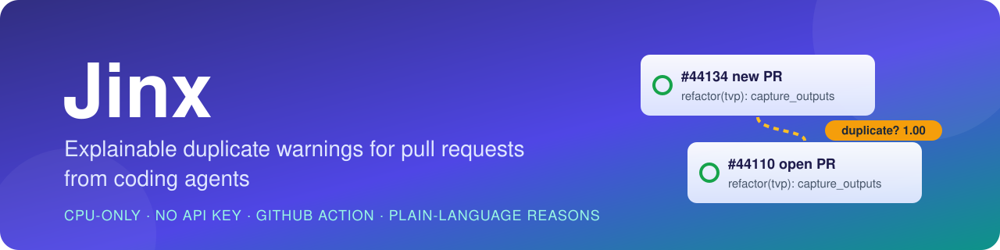
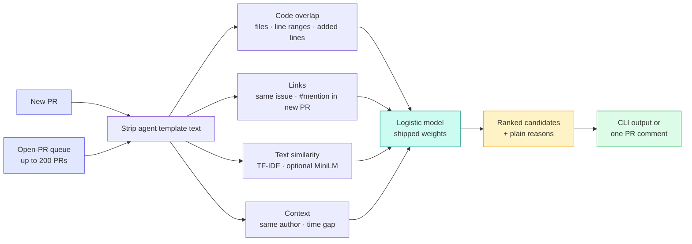
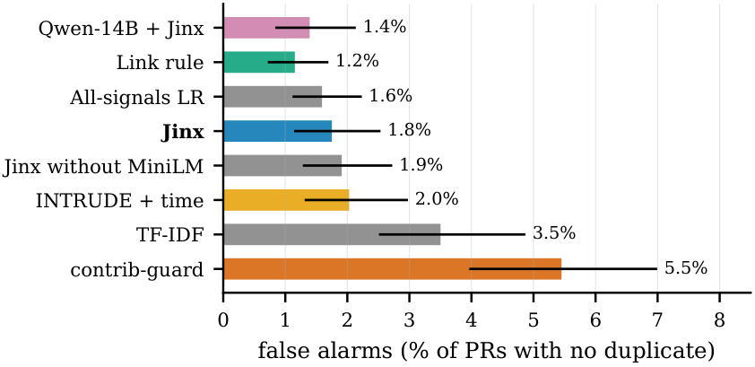
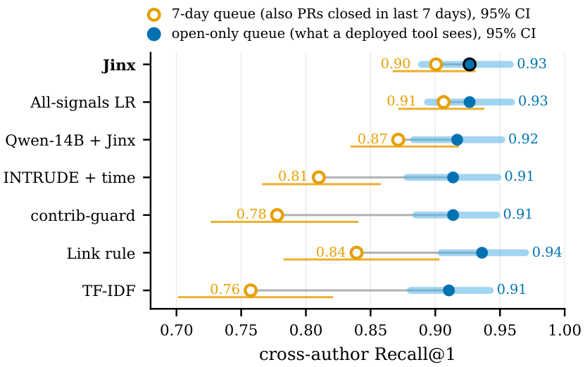

<p align="center">
  
</p>

<p align="center">
  <a href="LICENSE"></a>
  
  
  
  <a href="action.yml"></a>
  <a href="https://huggingface.co/datasets/hao-li/AIDev"></a>
  
</p>

<p align="center">
  <a href="#quickstart">Quickstart</a> ·
  <a href="#how-it-works">How it works</a> ·
  <a href="#github-action">GitHub Action</a> ·
  <a href="#results">Results</a> ·
  <a href="#papers">Papers</a>
</p>

---

**Jinx** finds pull requests in your open-PR queue that are likely to duplicate a new PR, and it tells you why.
It is built for PRs written by coding agents (Copilot, Codex, Devin, Claude Code, Cursor, Jules).

Agent PRs share long boilerplate (`## Summary ... ## Testing ... Generated with ...`). Plain text similarity is
misled by that boilerplate: unrelated agent PRs look alike, and a real duplicate written in different words is
missed. Jinx strips the template text and then compares the code, the links and the remaining words.

- 🔍 **Explainable.** Every match comes with plain reasons: shared files, overlapping lines, a shared issue.
- 💻 **Local and free.** It runs on CPU in about 6 ms per PR (median), with no LLM and no API key.
- 🎚️ **Tunable.** One threshold trades caught duplicates against false alarms.
- 🤖 **Drop-in Action.** It posts one comment on a new PR and updates it when the PR changes.

## Quickstart

```bash
pip install git+https://github.com/ABCR-Labs/Jinx     # adds the `jinx` command
# or, from a clone: pip install .   (pip install ".[embed]" adds the optional local MiniLM model)

jinx check examples/new_pr.json --open-queue examples/open_prs.jsonl --top 2
```

The example is a real queue from AIDev: huggingface/transformers #44134 and the 19 PRs that were open when it
was created.

```text
PR #44134: checked 19 open PRs in 12 ms. 1 likely duplicate(s) (score >= 0.50).
  DUPLICATE? #44110  score 1.00  refactor(tvp): use capture_outputs for output tracing
               - one PR links to the other (#44110)
               - shares 1 of 1 changed files (src/transformers/models/tvp/modeling_tvp.py)
               - 100% of changed line ranges overlap
               - 100% of added lines are identical
               - similar title/description after removing agent template text (0.92)
             #44133  score 0.05  refactor(poolformer): use capture_outputs for output tracing
               - similar title/description after removing agent template text (0.50)
               - same author (possible re-opened or replacement PR)
```

Input uses the GitHub API's JSON shape (`number`, `title`, `body`, `user.login`, `created_at`). The optional
fields are `diff` (unified diff text), `files`, `agent` and `linked_issues`. The queue can be a JSON list or a
JSON-lines file.

| Flag | What it does |
|---|---|
| `--top N` | List at most N candidates |
| `--threshold X` | Flag only scores ≥ X (default 0.5) |
| `--json` | Machine-readable output |
| `--embed` | Also use the local MiniLM text model (needs `.[embed]`) |
| `--templates FILE` | Use templates learned from your own PRs |

## How it works



1. **Remove template text.** The template lines were learned from 361k agent PRs in AIDev; lines repeated across the current queue are removed too.
2. **Compare the code:** shared files, overlapping changed line ranges, identical added lines.
3. **Check links:** the same linked issue, or the new PR mentioning the other one.
4. **Add context:** the same author, and the time gap between the PRs.
5. **Combine** these with a small logistic model. The shipped weights are in `src/jinx_pr/data/weights.json` (lexical) and `weights_emb.json` (`--embed`), trained on all 4,832 AIDev queue queries by `experiments/bench_v2/train_package_weights.py`.

## GitHub Action

```yaml
# .github/workflows/jinx.yml
name: jinx
on:
  pull_request_target:
    types: [opened, reopened, synchronize, edited]
permissions:
  contents: read
  pull-requests: write
  issues: write
jobs:
  check:
    runs-on: ubuntu-latest
    steps:
      - uses: ABCR-Labs/Jinx@main
        with:
          threshold: ""        # empty = bundled default (0.5)
          max-open-prs: "200"
          top: "3"
          embed: "false"       # "true" adds MiniLM (installs PyTorch on every run)
```

The Action reads PR metadata and diffs through the API and posts or updates one comment. It never checks out or
runs the PR's code, which keeps `pull_request_target` safe.

## Results

These results come from the AIDev benchmark (v5). We replayed each new PR against the PRs that were open when
it arrived, capped to the 200 most recent. The table shows the 313 duplicate pairs written by different authors,
and false alarms on PRs that have no duplicate.

| Method | Right PR ranked first (Recall@1) | False alarms | Needs |
|---|:---:|:---:|---|
| **Jinx** (with MiniLM) | **0.927** | **1.8%** | CPU |
| Jinx, lexical only (Action default) | 0.917 | 1.9% | CPU |
| Link rule (TF-IDF tie-break) | 0.936 | 1.2% | CPU |
| INTRUDE + time (Wang et al. 2019) | 0.914 | 2.0% | CPU |
| contrib-guard (existing bot) | 0.914 | 5.5% | CPU |
| TF-IDF text only | 0.911 | 3.5% | CPU |
| Claude Haiku 4.5 + Jinx | 0.936 | 0.8%\* | API, about 0.8¢ per PR |

\* Measured on a random sample of 1,600 PRs without a duplicate; Jinx raises 1.7% on the same sample.

All the strong methods rank about equally well: every difference in Recall@1 between them is within noise. They
differ mainly in false alarms, and Jinx raises about a third as many as the best existing bot. Jinx's value is
explanations, packaging and local operation, not higher accuracy.

<p align="center">
  
  
</p>

How you build the evaluation queue changes the winner. If the queue also keeps PRs closed in the last 7 days,
Jinx leads INTRUDE + time by 9 points; on real open-only queues the methods tie. The full study of 66 strategies
is in [`experiments/`](experiments/) and [`experiments/report/REPORT.md`](experiments/report/REPORT.md).

## Learn templates for your own PRs

```bash
jinx learn-templates corpus.jsonl -o my_templates.json   # JSON-lines with agent, repo, body
jinx check new.json --open-queue open.jsonl --templates my_templates.json
```

## Papers

The LaTeX sources and PDFs are in [`paper/`](paper/), and `make -C paper` regenerates every number, table and
figure from the result files.

- *How You Build the Queue Decides the Winner: Re-Evaluating Duplicate Pull Request Detection on Coding-Agent PRs*: the empirical study ([PDF](paper/empirical/main.pdf)).
- *Jinx: Explainable Duplicate Warnings for Pull Requests from Coding Agents*: the tool demo ([PDF](paper/tooldemo/main.pdf)).

[`docs/DATA_CARD.md`](docs/DATA_CARD.md) describes the benchmark and [`CHECKLIST.md`](CHECKLIST.md) tracks open items.

## Development

```bash
pip install -e ".[dev]"
python -m pytest -q
ruff check src tests
```

## License

MIT. The benchmark is derived from [AIDev](https://huggingface.co/datasets/hao-li/AIDev) (CC BY 4.0).
Authors: Harshul Jain, Saurabh Yergattikar and Tanya Sah. Jinx was formerly named AgentDup.
