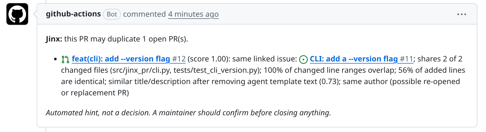
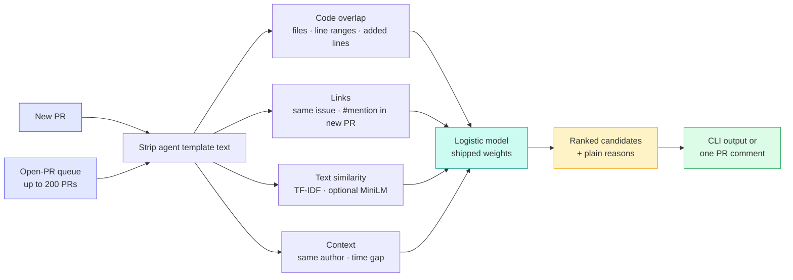

<p align="center">
  
</p>

<p align="center">
  <a href="LICENSE"></a>
  
  
  
  <a href="action.yml"></a>
  <a href="https://huggingface.co/datasets/hao-li/AIDev"></a>
  
</p>

<p align="center">
  <a href="#what-it-looks-like">What it looks like</a> ·
  <a href="#how-it-compares">How it compares</a> ·
  <a href="#add-it-to-your-repo">Add it to your repo</a> ·
  <a href="#how-it-works">How it works</a> ·
  <a href="#the-research">The research</a>
</p>

---

**Jinx stops your team from reviewing the same pull request twice.**

Coding agents (Copilot, Codex, Devin, Claude Code, Cursor, Jules) open a lot of PRs, and some of them redo work
that is already open. Jinx checks each new PR against the open ones. When it finds a likely duplicate, it leaves
one short comment that says which PR it matches and why.

- 💬 **Tells you why.** Shared files, the same lines changed, the same issue. You can decide in seconds.
- 🔕 **Quiet.** About 2 false alarms per 100 PRs: under half of what the existing bots we tested raise, and a third of the best one's.
- 💻 **Free and local.** It runs on the CI machine's CPU in about 6 ms per PR. No LLM, no API key, and no code leaves GitHub.
- 🛡️ **Safe.** It only reads PR data through the GitHub API. It never runs the PR's code, and it never closes or blocks anything.

A one-page website with the same story and an interactive comparison is in [`site/`](site/). See [Website](#website).

## What it looks like

A real comment from a live run on this repository. PR #15 redid the work of open PR #12:

<p align="center"></p>

## How it compares

We replayed 313 real duplicate PRs from the public [AIDev](https://huggingface.co/datasets/hao-li/AIDev) dataset.
Each time, every method looked at the PRs that were open at that moment, as a bot would.

| Method | Finds the right PR first (of 100) | False alarms (per 100 PRs with no duplicate) | Notes |
|---|:---:|:---:|---|
| **Jinx** (Action default) | 92 | **1.9** | Explains each match (files, lines, issue, text). Free, CPU only |
| Jinx + MiniLM (optional) | 93 | 1.8 | Adds a local text model; installs PyTorch |
| Link rule (same issue or #mention) | 94 | 1.2 | Only says "they share a link"; falls back to text similarity |
| INTRUDE + time (research detector) | 91 | 2.0 | Published method, no ready-to-install tool |
| contrib-guard (existing bot) | 91 | 5.5 | Best existing bot we tested |
| Simili-bot (existing bot, re-implemented) | 88 | 4.5 | |
| PRSense (existing bot, re-implemented) | 83 | 4.7 | |
| Claude Haiku 4.5 + Jinx | 94 | 0.8\* | Needs an API key, about 0.8¢ per PR |

\* On a random sample of 1,600 PRs with no duplicate, where Jinx raises 1.7.

**In short:** the good methods find the right PR about equally often. What sets Jinx apart is that it raises under half
the false alarms of the existing bots, says exactly why it matched, and is ready to install. A simple
link rule is just as good when the PRs link the same issue, but it can only say "they share a link".

<p align="center">
  
</p>

## Add it to your repo

Create `.github/workflows/jinx.yml`:

```yaml
name: jinx
on:
  pull_request_target:
    types: [opened, reopened, synchronize, edited]
permissions:
  contents: read
  pull-requests: write
  issues: write
jobs:
  check:
    runs-on: ubuntu-latest
    steps:
      - uses: ABCR-Labs/Jinx@main
        with:
          threshold: ""        # empty = bundled default (0.5); lower catches more, with more false alarms
          max-open-prs: "200"
          top: "3"
          embed: "false"       # "true" adds MiniLM (installs PyTorch on every run)
```

That's it. Jinx posts one comment on a new PR when it finds a likely duplicate, and updates that comment when the PR changes.
`pull_request_target` is safe here because Jinx never checks out or runs the PR's code.

### Or use the command line

```bash
pip install git+https://github.com/ABCR-Labs/Jinx   # adds the `jinx` command
# from a clone: pip install .  (or ".[embed]" for the optional MiniLM model)

jinx check examples/new_pr.json --open-queue examples/open_prs.jsonl --top 2
```

The example is a real queue from AIDev: huggingface/transformers #44134 and the 19 PRs that were open when it
was created.

```text
PR #44134: checked 19 open PRs in 12 ms. 1 likely duplicate(s) (score >= 0.50).
  DUPLICATE? #44110  score 1.00  refactor(tvp): use capture_outputs for output tracing
               - one PR links to the other (#44110)
               - shares 1 of 1 changed files (src/transformers/models/tvp/modeling_tvp.py)
               - 100% of changed line ranges overlap
               - 100% of added lines are identical
               - similar title/description after removing agent template text (0.92)
             #44133  score 0.05  refactor(poolformer): use capture_outputs for output tracing
               - similar title/description after removing agent template text (0.50)
               - same author (possible re-opened or replacement PR)
```

Input uses the GitHub API's JSON shape (`number`, `title`, `body`, `user.login`, `created_at`). The optional
fields are `diff` (unified diff text), `files`, `agent` and `linked_issues`. The queue can be a JSON list or a
JSON-lines file.

| Flag | What it does |
|---|---|
| `--top N` | List at most N candidates |
| `--threshold X` | Flag only scores ≥ X (default 0.5) |
| `--json` | Machine-readable output |
| `--embed` | Also use the local MiniLM text model (needs `.[embed]`) |
| `--templates FILE` | Use templates learned from your own PRs |

## How it works



1. **Remove template text.** The template lines were learned from 361k agent PRs in AIDev; lines repeated across the current queue are removed too.
2. **Compare the code:** shared files, overlapping changed line ranges, identical added lines.
3. **Check links:** the same linked issue, or the new PR mentioning the other one.
4. **Add context:** the same author, and the time gap between the PRs.
5. **Combine** these with a small logistic model. The shipped weights are in `src/jinx_pr/data/weights.json` (lexical) and `weights_emb.json` (`--embed`), trained on all 4,832 AIDev queue queries by `experiments/bench_v2/train_package_weights.py`.

## Website

[`site/`](site/) is a static one-page website (plain HTML, CSS and JS, no build step). It has the pitch, the live comment,
the comparison table, and a slider that shows how many duplicates each method catches at a chosen false-alarm level.
Every number comes from `experiments/results/` through `python3 site/make_data.py`.

- **Vercel:** import the repo; `vercel.json` serves `site/`.
- **Netlify:** import the repo; `netlify.toml` publishes `site/`.
- **Locally:** `python3 -m http.server -d site` and open http://localhost:8000.

## The research

How you build the evaluation queue changes which method looks best. If the queue also keeps PRs closed in the
last 7 days, Jinx leads the research detector by 9 points; on real open-only queues the methods tie. The full study
of 66 strategies is in [`experiments/`](experiments/) and [`experiments/report/REPORT.md`](experiments/report/REPORT.md).

<p align="center">
  
</p>

## Learn templates for your own PRs

```bash
jinx learn-templates corpus.jsonl -o my_templates.json   # JSON-lines with agent, repo, body
jinx check new.json --open-queue open.jsonl --templates my_templates.json
```

### Papers

The LaTeX sources and PDFs are in [`paper/`](paper/), and `make -C paper` regenerates every number, table and
figure from the result files.

- *How You Build the Queue Decides the Winner: Re-Evaluating Duplicate Pull Request Detection on Coding-Agent PRs*: the empirical study ([PDF](paper/empirical/main.pdf)).
- *Jinx: Explainable Duplicate Warnings for Pull Requests from Coding Agents*: the tool demo ([PDF](paper/tooldemo/main.pdf)).

[`docs/DATA_CARD.md`](docs/DATA_CARD.md) describes the benchmark and [`CHECKLIST.md`](CHECKLIST.md) tracks open items.

## Development

```bash
pip install -e ".[dev]"
python -m pytest -q
ruff check src tests
```

## License

MIT. The benchmark is derived from [AIDev](https://huggingface.co/datasets/hao-li/AIDev) (CC BY 4.0).
Authors: Harshul Jain, Saurabh Yergattikar, Tanya Sah and Parv Khatri. Jinx was formerly named AgentDup.
